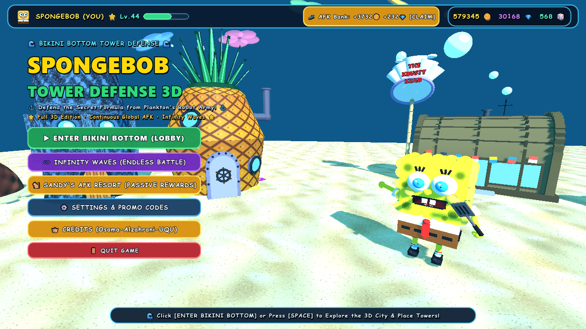
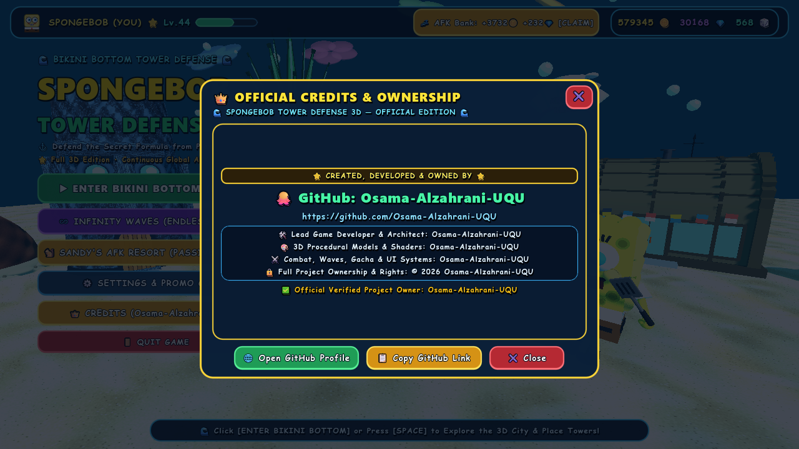
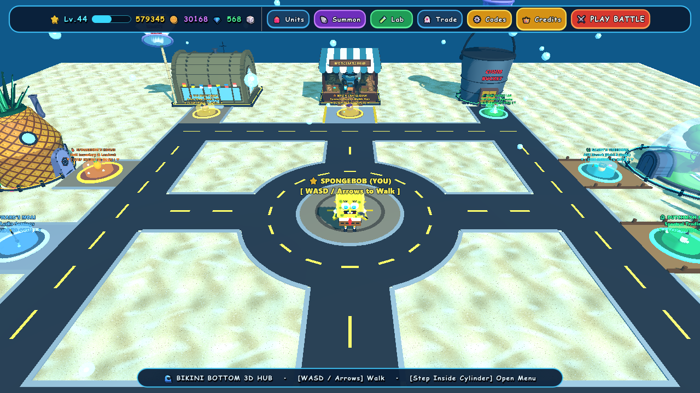
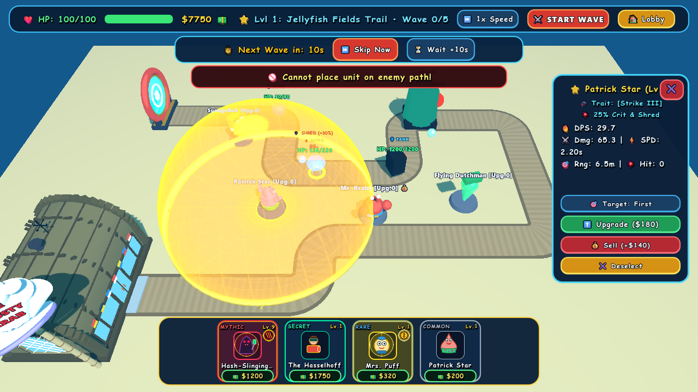
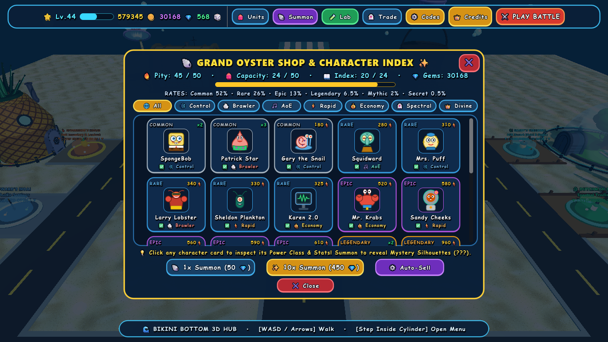
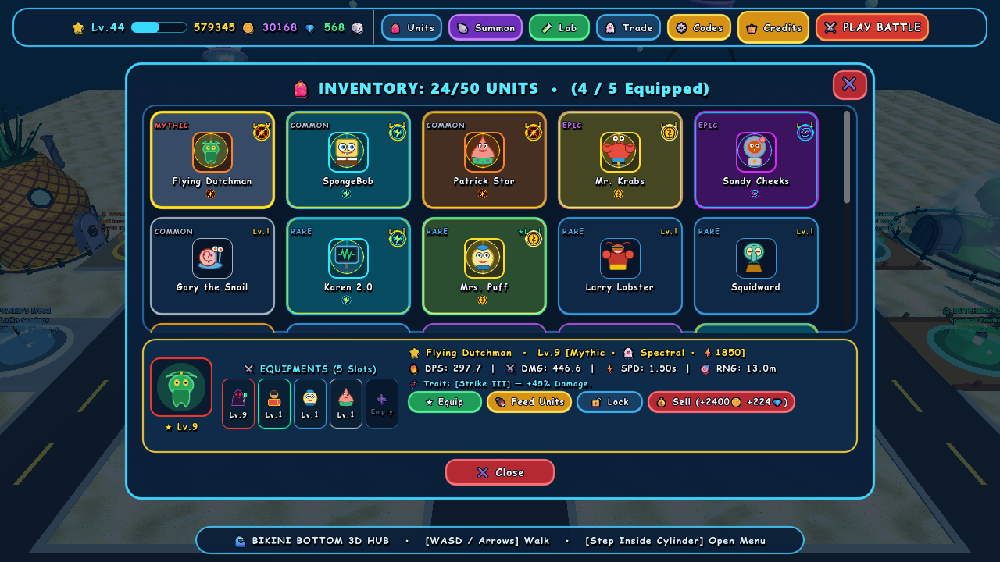
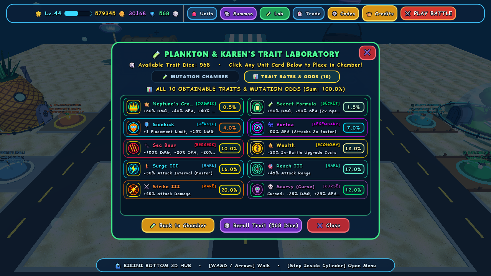
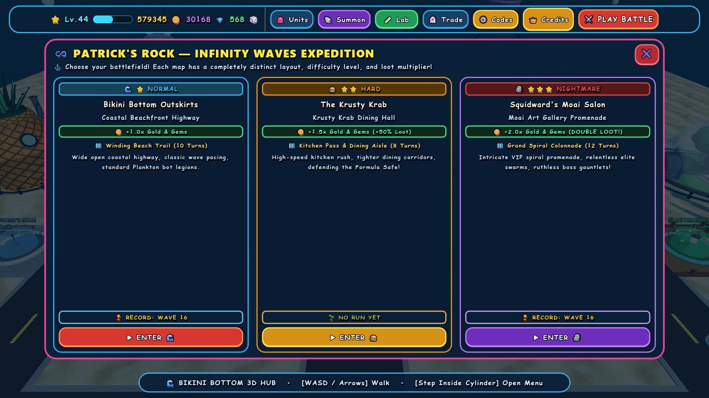

# 🧽 SpongeBob Tower Defense (3D) — Official Edition

[](https://github.com/Osama-Alzahrani-UQU)
[-478CBF?style=for-the-badge&logo=godotengine)](https://godotengine.org)
[](./LICENSE)

---

## 👑 Official Ownership & Creator Attribution

- **Project Creator, Lead Developer & Sole Owner:** **Osama Alzahrani** ([`@Osama-Alzahrani-UQU`](https://github.com/Osama-Alzahrani-UQU))
- **Official GitHub Profile:** [https://github.com/Osama-Alzahrani-UQU](https://github.com/Osama-Alzahrani-UQU)
- **Copyright:** © 2026 **Osama-Alzahrani-UQU**. All Rights & Ownership Reserved.
- **In-Game Verification:** Accessible directly via the **👑 CREDITS (Osama-Alzahrani-UQU)** button in the Main Menu and 3D Lobby TopBar.

---

## 📸 Live In-Game 3D Screenshots

### 🌊 1. 3D Main Menu Vista & Official Ownership Credits
| **3D Main Menu & SpongeBob Vista** | **Official In-Game Credits (`Osama-Alzahrani-UQU`)** |
| :---: | :---: |
|  |  |

### 🏙️ 2. Walkable 3D Bikini Bottom Open Hub & Tactical 3D Battle
| **3D Bikini Bottom Open Hub (`Lobby`)** | **Active 3D Battle, Range Dome & Wave Controls** |
| :---: | :---: |
|  |  |

### 🐚 3. Summon Shop (24 Characters & Auto-Sell) & 50-Unit Inventory (Lock/Unlock)
| **Grand Oyster Summon Shop & Character Index** | **Units Inventory (50 Max, Equipments & Unit Lock)** |
| :---: | :---: |
|  |  |

### 🧪 4. Plankton's Trait Lab (0.5% Neptune's Crown) & Infinity Waves Mode
| **Plankton's Trait Laboratory & Mutation Odds** | **Patrick's Rock — Infinity Waves Expedition** |
| :---: | :---: |
|  |  |

---

## 🌊 Overview

**SpongeBob Tower Defense (3D)** is a full-featured 3D tower defense game built in **Godot 4 (Forward+)** featuring procedural 3D characters, articulated idle & attack animations, a walkable 3D Bikini Bottom open-world hub, 15 campaign stages across 3 distinct zones, an endless Infinity Waves mode, a 24-character gacha summon shop with auto-sell, Plankton's Trait Lab, Flying Dutchman trading market, and Sandy's continuous AFK resort.

---

## ✨ Key Features

1. **Walkable 3D Bikini Bottom Open Hub (`Lobby`)**
   - Explore Conch Street, SpongeBob's Pineapple, Patrick's Rock, Squidward's Moai, The Krusty Krab, Chum Bucket Lab, Sandy's Treedome, and the Flying Dutchman's Ghost Ship.
   - Cinematic parabolic sky-arc teleportation with bubble vortex & shockwave effects.

2. **24 Iconic Characters & Articulated 3D Animations**
   - Smooth high-segment procedural 3D models with toon shading, articulated limb pivots (`BodyPivot`, `LeftArmPivot`, `RightArmPivot`), organic breathing idle animations, and multi-phase attack animations.
   - 7 Power Classifications (`Control`, `Brawler`, `AOE`, `Marksman`, `Economy`, `Spectral`, `Cosmic`) and 6 Rarity Tiers (`Common` 52% down to `Secret` 0.5%).

3. **3 Distinct Zones & 15 Sequential Campaign Stages**
   - **Zone 1:** Bikini Bottom Outskirts (Coastal Serpentine Trail).
   - **Zone 2:** The Krusty Krab Interior (Kitchen & Dining Corridor defending the Secret Formula Safe).
   - **Zone 3:** Squidward's Moai Art Salon (Grand Spiral Colonnade defending Squidward's Concert Clarinet).
   - Sequential stage progression requiring clearing each stage to unlock the next.

4. **Infinity Waves Mode (`Patrick's Rock`)**
   - Map & difficulty selector with reward multipliers (`1.0x Normal`, `1.5x Hard`, `2.0x Nightmare`) and persistent wave records per map.

5. **Tactical Combat & Wave Systems**
   - Real-time placement validation preventing road/unit overlap with dynamic green/crimson `RangeDome3D` shader feedback.
   - Penultimate enemy 10-second wave countdown with `⏩ Skip Now` and `⏳ Wait +10s` controls.
   - Overhead 3D enemy ability badges (`⚡ SPEED`, `🛡️ TANK`, `👑 BOSS`, `💨 SCOUT`).

6. **Summon Shop, Auto-Sell, Inventory Capacity & Unit Lock**
   - Full pack-opening cinematic with 10-second summary modal.
   - Configurable **Auto-Sell** by rarity or individual unit.
   - 50-unit inventory capacity limit with **Lock / Unlock** protection against accidental selling or feeding.

7. **Plankton's Trait Lab & Odds Table**
   - 10 unique traits with transparent roll probabilities (down to `0.5%` for **Neptune's Crown**).

---

## 🚀 Running the Project

```bash
# Launch the game
godot --path .

# Run the automated 10-stage verification suite headlessly
godot --headless "res://scenes/tests/auto_tester.tscn"
```

---

## 📜 License & Proof of Ownership

This project is owned by **[Osama-Alzahrani-UQU](https://github.com/Osama-Alzahrani-UQU)**. See [LICENSE](./LICENSE) for full details.
